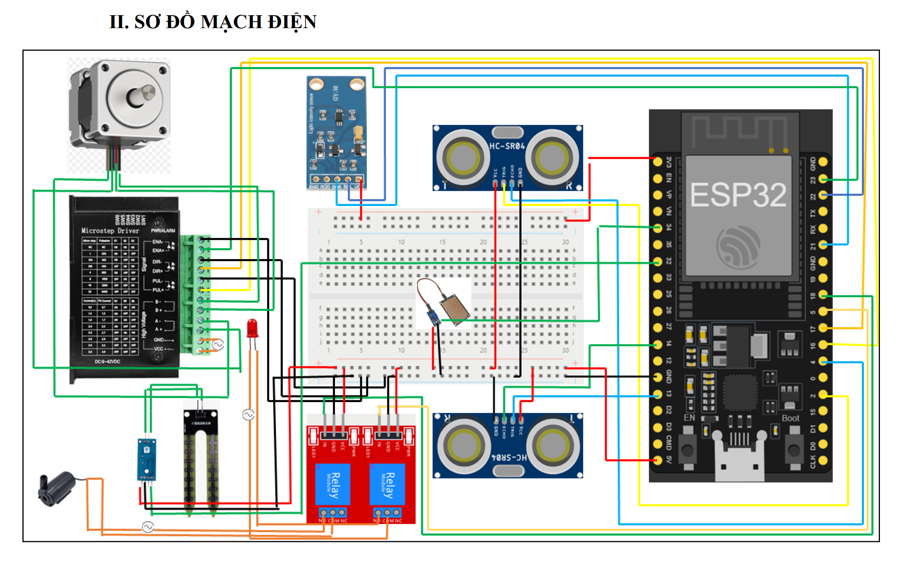

**IoT Smart Vegetable Growing Box**

An end-to-end IoT agriculture system built with an ESP32 microcontroller, Node-RED, and Firebase. This system automates plant care by monitoring environmental factors (soil moisture, rain, light intensity, and physical obstacles) and automatically controlling a water pump, step motor (for the lid), and LED lighting.

**Video Demonstration**
You can watch the full system demonstration (in Vietnamese) here: https://www.youtube.com/watch?v=2in8Z4GgJgM

**System Architecture & Circuit Diagram**
The system uses an ESP32 connected to ultrasonic sensors, a rain sensor, a soil moisture sensor, and a BH1750 light sensor. Actuators include relays for a water pump and LED, plus a step motor driver.



**Hardware Dependencies**
To compile the C++ code for the ESP32, you will need to install the following libraries via the Arduino IDE Library Manager:
*   PubSubClient (by Nick O'Leary)
*   ArduinoJson (by Benoit Blanchon)
*   BH1750 (by Christopher Laws)
*   DHT sensor library (by Adafruit)

**How to Import the Node-RED Dashboard**
The entire web interface and MQTT-to-Firebase routing logic is contained within a single Node-RED flow.
1. Open your local or cloud instance of Node-RED.
2. Click the hamburger menu in the top right corner and select **Import**.
3. Select the `node_red_design.json` file from this repository.
4. Click **Import** and then click **Deploy** in the top right corner.
5. Navigate to your Node-RED UI path (usually `http://localhost:1880/ui`) to view the dashboard.

**Firebase Realtime Database Structure**
The system uses Firebase via REST APIs to manage user authentication and store sensor states. Node-RED automatically generates the following JSON tree structure:

```json
{
  "Users": {
    "user_email@gmail_com": {
      "password": "hashed_password"
    }
  },
  "IoT_Device_1": {
    "Current_State": {
      "Moisture": 30.3,
      "Rain_intensity": 20.4,
      "Light_intensity": 32,
      "Obstacle": "Yes"
    },
    "Thresholds": {
      "Min_moisture": 10,
      "Max_rain": 100,
      "Max_light": 100
    },
    "History": [
      {"action": "Mở nắp thùng", "time": "12/21/2023, 2:59:51"},
      {"action": "Bật đèn", "time": "12/21/2023, 2:50:37"}
    ]
  }
}
```

**IFTTT Push Notifications**
The Node-RED flow is configured to send HTTP POST requests to IFTTT webhooks. This triggers real-time smartphone push notifications when critical events occur, such as a physical obstacle blocking the lid, heavy rain, or low soil moisture.